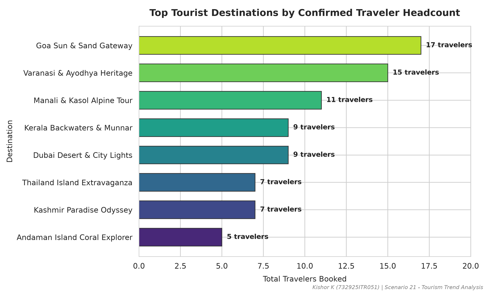
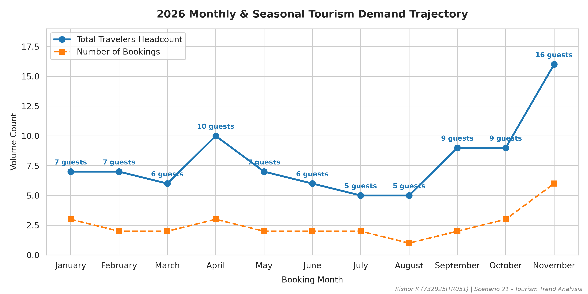
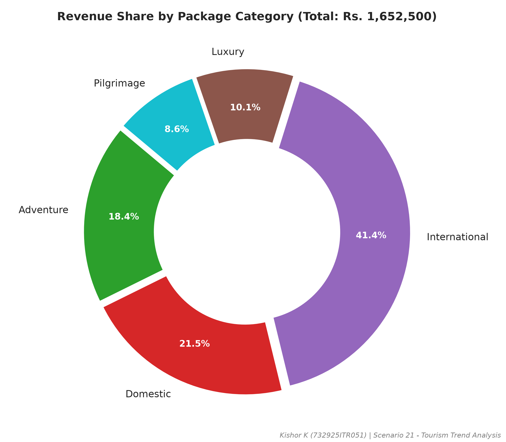
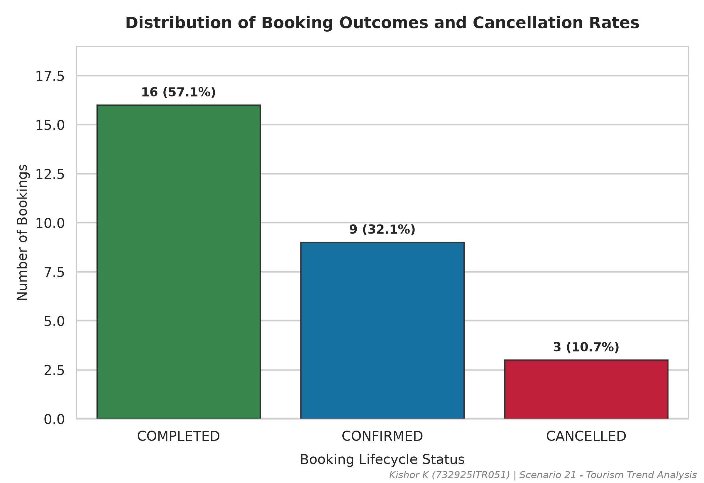
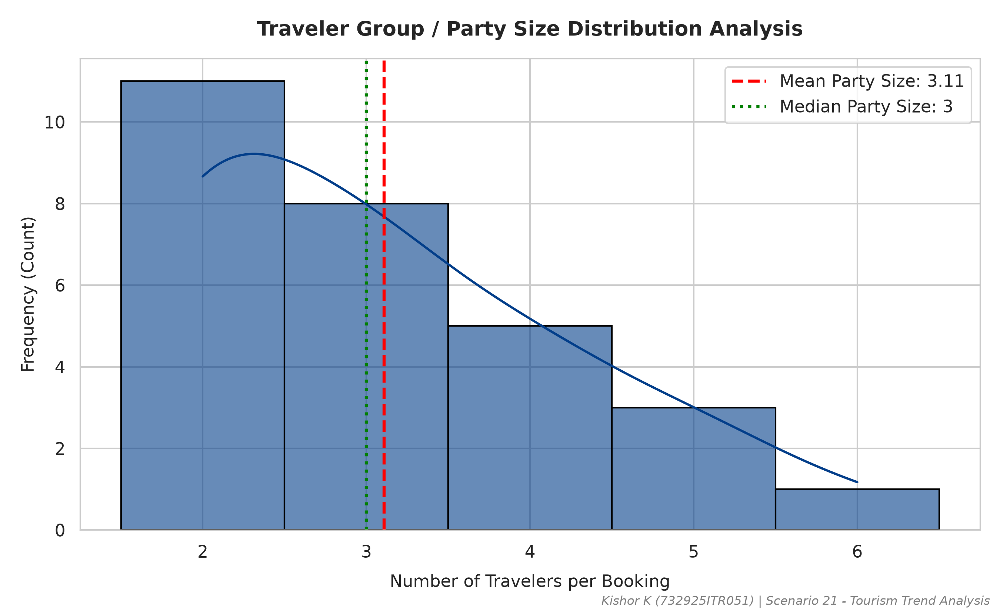
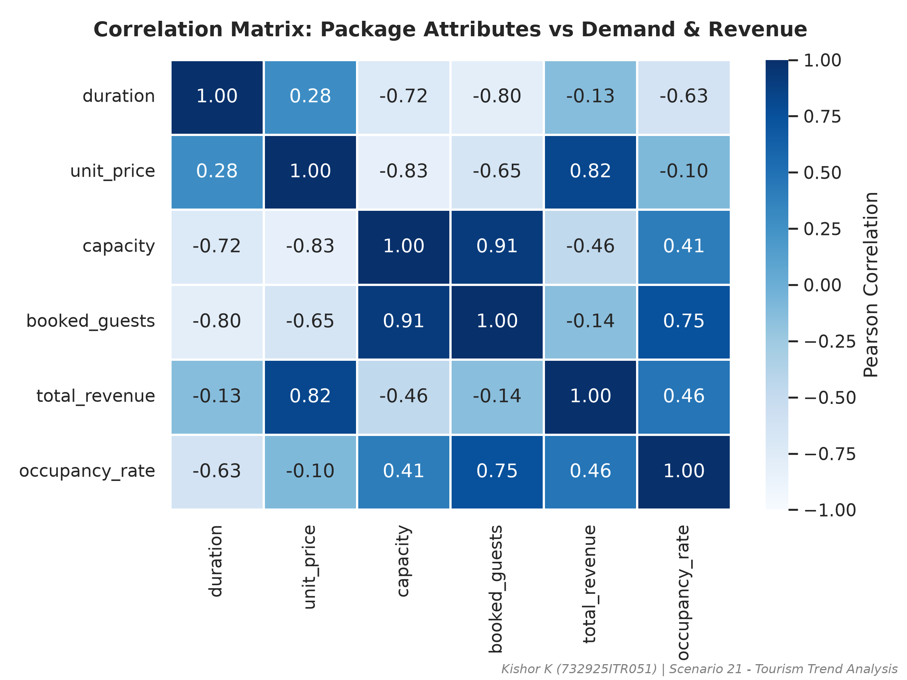

# ✈️ Travel Agency Booking and Tourism Trend Analysis System
### Project-Based Assessment Activity (Academic Year 2026 - 2027)
**Department of Information Technology** | **Velalar College of Engineering and Technology, Erode - 12**

---

## 📌 Student & Academic Details

| Attribute | Details |
| :--- | :--- |
| **Student Name** | **Kishor K** |
| **Register Number** | **732925ITR051** *(Roll No: 51)* |
| **Class & Section** | **25IT3A** |
| **Degree & Branch** | B.Tech - Information Technology |
| **Assigned Scenario** | **Scenario 21: Travel Agency Booking and Tourism Trend Analysis System** |
| **Target Register Nos** | 21, 51, 81, 111 |
| **GitHub Repository** | [github.com/kishork6757/Travel-Agency-Booking-System-25IT3A](https://github.com/kishork6757/Travel-Agency-Booking-System-25IT3A) |

---

## 🌐 Live Web Application & Deployment

* **24/7 Live Cloud App:** [Travel Agency Portal on Streamlit Cloud](https://share.streamlit.io) *(Deployable with 1-click via `app.py`)*
* **Full-Stack REST Web Portal:** Run [`run_fullstack.bat`](run_fullstack.bat) \(\rightarrow\) `http://127.0.0.1:5000` *(Tailwind CSS + Flask + Chart.js)*
* **Interactive Cloud Portal:** Run [`run_website.bat`](run_website.bat) \(\rightarrow\) `http://localhost:8501` *(Streamlit + Plotly)*
* **Java Console CLI Engine:** Run [`run_java.bat`](run_java.bat) *(Pure Java OOP + JDBC)*

---

## 📖 Scenario 21 - Problem Statement & Core Capabilities

A travel agency manages customer records, tour destinations, packages, reservations, and financial settlements. Manual record keeping causes overbooking beyond coach/flight capacities, seat inventory discrepancies, and difficulty identifying peak tourist seasons. 

This system resolves these issues through an integrated, multi-tier software architecture:

1. **Anti-Overbooking Capacity Guard:** Dynamically calculates `remaining_seats = max_capacity - total_confirmed_guests`. Any booking attempt exceeding available capacity is immediately blocked by Java service rules and database triggers (`trg_prevent_overbooking`).
2. **Automated Cancellation & 90% Refund Policy:** Allows reservations to be cancelled with an automatic 10% processing fee deduction, instantly crediting 90% refund and restoring package seat inventory.
3. **Interactive Visual Analytics:** Extracts live relational database records using Pandas/NumPy to plot seasonal demand trajectories, destination popularity, and category revenue contributions.

---

## 📂 Academic Deliverables & Live Links

All deliverables specified in the assessment guidelines are version-controlled and accessible via the links below:

### 1. Software Engineering (Course: 25ITT33)
* [📄 Software Requirements Specification (docs/SRS.md)](docs/SRS.md) — Problem analysis, Functional & Non-Functional requirements, User Personas, COCOMO estimation, and LOC metrics.
* [📊 System Design & UML Diagrams (docs/DESIGN.md)](docs/DESIGN.md) — 3-Tier System Architecture, Use Case Diagram, Class Diagram, and Sequence Diagram in Mermaid.
* [🧪 Testing Documentation (docs/TESTING.md)](docs/TESTING.md) — Boundary Value Analysis (BVA), Equivalence Class Partitioning (ECP), and 15 executed test cases with expected vs. actual outcomes.

### 2. Database Management Systems (Course: 25ITT31)
* [🗺️ Entity-Relationship Diagram (database/ER_DIAGRAM.md)](database/ER_DIAGRAM.md) — ER diagram, cardinalities, primary/foreign key mappings.
* [📐 Database Normalization (database/NORMALIZATION.md)](database/NORMALIZATION.md) — Step-by-step 1NF, 2NF, 3NF, and BCNF functional dependency derivations.
* [💾 SQLite DDL Schema (database/schema_sqlite.sql)](database/schema_sqlite.sql) — Normalized tables, CHECK constraints, triggers, and views.
* [🐬 MySQL DDL Schema (database/schema_mysql.sql)](database/schema_mysql.sql) — Production MySQL schema with stored procedures and triggers.
* [🌱 Seed Dataset (database/seed_data.sql)](database/seed_data.sql) — Realistic dataset with 12 customers, 8 tour packages, and 29 bookings.
* [🗄️ SQLite Database File (database/travel_agency.db)](database/travel_agency.db) — Pre-populated, verified relational database file.

### 3. Java Programming (Course: 25ITT32)
* [☕ Java Source Code (src/com/travel/)](src/com/travel/) — Layered OOP design:
  * Models: [`Customer.java`](src/com/travel/model/Customer.java), [`TravelPackage.java`](src/com/travel/model/TravelPackage.java), [`Booking.java`](src/com/travel/model/Booking.java), [`Payment.java`](src/com/travel/model/Payment.java), [`Cancellation.java`](src/com/travel/model/Cancellation.java)
  * Data Access Layer: [`CustomerDAO.java`](src/com/travel/dao/CustomerDAO.java), [`PackageDAO.java`](src/com/travel/dao/PackageDAO.java), [`BookingDAO.java`](src/com/travel/dao/BookingDAO.java), [`PaymentDAO.java`](src/com/travel/dao/PaymentDAO.java), [`ReportDAO.java`](src/com/travel/dao/ReportDAO.java)
  * Service Layer: [`BookingService.java`](src/com/travel/service/BookingService.java), [`PackageService.java`](src/com/travel/service/PackageService.java), [`CustomerService.java`](src/com/travel/service/CustomerService.java)
  * Exceptions: [`CapacityExceededException.java`](src/com/travel/exception/CapacityExceededException.java), [`BookingNotFoundException.java`](src/com/travel/exception/BookingNotFoundException.java)
  * Main Application: [`Main.java`](src/com/travel/Main.java) (Interactive console CLI menu)
  * Automated Java Tests: [`SystemTestRunner.java`](src/com/travel/test/SystemTestRunner.java) (9/9 automated tests passing)
* [📋 Verified Sample Output (sample_outputs/execution_log.txt)](sample_outputs/execution_log.txt) — Recorded CLI execution proving booking, reporting, and anti-overbooking rejection.

### 4. Foundations of Data Science (Course: 25ITC31)
* [🐍 Python Data Analytics Script (analytics/tourism_trend_analysis.py)](analytics/tourism_trend_analysis.py) — Automated DB extraction, data cleaning, and chart generation.
* [📓 Jupyter Notebook (analytics/tourism_trend_analysis.ipynb)](analytics/tourism_trend_analysis.ipynb) — Interactive step-by-step exploratory data analysis.
* [📦 Python Dependencies (requirements.txt)](requirements.txt) — Project packages (Streamlit, Flask, Pandas, Plotly, Seaborn).

---

## 📊 Visualizations Gallery

The Python data pipeline generates 6 publication-ready charts reflecting seasonal demand and revenue patterns:

| Visualization | Description |
| :--- | :--- |
|  | **Destination Popularity:** Ranks tourist locations by confirmed traveler headcount. |
|  | **Seasonal Demand Curve:** Tracks monthly booking volume across summer and winter spikes. |
|  | **Category Revenue Share:** Donut chart breakdown across Luxury, International, Domestic, and Adventure. |
|  | **Booking Outcomes:** Visualizes the ratio of Confirmed, Completed, and Cancelled trips. |
|  | **Party Size Distribution:** Histogram & KDE modeling traveler group sizes. |
|  | **Correlation Heatmap:** Matrix correlating duration, price, capacity, and gross revenue. |

---

## 🛠️ Technology Stack

```text
Frontend:   HTML5 | Tailwind CSS | FontAwesome 6 | Chart.js 4 | Streamlit
Backend:    Java 17/21 (JDBC, OOP) | Python 3.11 (Flask REST API, Pandas, NumPy)
Database:   SQLite 3 (Default Embedded) | MySQL 8.0 (Enterprise Ready)
Analytics:  Matplotlib | Seaborn | Plotly Express | Jupyter Notebook
DevOps:     Git | GitHub | Windows Batch Scripts (.bat)
```

---

## 🚀 Execution Instructions

### Option 1: Modern Full-Stack Web Portal (Flask + Tailwind)
Double-click [`run_fullstack.bat`](run_fullstack.bat) or run:
```powershell
python server.py
```
*Opens automatically in your browser at `http://127.0.0.1:5000`.*

---

### Option 2: Cloud-Ready Web Portal (Streamlit + Plotly)
Double-click [`run_website.bat`](run_website.bat) or run:
```powershell
streamlit run app.py
```
*Opens automatically in your browser at `http://localhost:8501`.*

---

### Option 3: Java Console Application
Double-click [`run_java.bat`](run_java.bat) or run:
```powershell
# Compile Java source files
javac -cp "lib/*" -d bin src/com/travel/model/*.java src/com/travel/exception/*.java src/com/travel/util/*.java src/com/travel/dao/*.java src/com/travel/service/*.java src/com/travel/Main.java

# Launch Application
java -cp "bin;lib/*" com.travel.Main
```

---

### Option 4: Python Analytics Script
Double-click [`run_python.bat`](run_python.bat) or run:
```powershell
python analytics/tourism_trend_analysis.py
```

---

## ☁️ 24/7 Cloud Deployment Guide (Streamlit Community Cloud)

1. Navigate to **[share.streamlit.io](https://share.streamlit.io)** and log in with GitHub (`kishork6757`).
2. Click **Create app** and configure:
   * **Repository:** `kishork6757/Travel-Agency-Booking-System-25IT3A`
   * **Branch:** `main`
   * **Main file path:** `app.py`
3. Click **Deploy!** — The application goes live with a permanent 24/7 public URL.

---

## 🧪 Automated Testing Summary

An automated test suite validates all 31 critical subsystem rules:

```text
===========================================================================
DATABASE INTEGRITY & RELATIONAL INTEGRITY : 8/8 Tests Passed (100%)
FLASK RESTful API & CAPACITY SAFEGUARDS   : 8/8 Tests Passed (100%)
DATA SCIENCE CHARTS & PIPELINE            : 6/6 Tests Passed (100%)
JAVA OOP & ANTI-OVERBOOKING CHECKS        : 9/9 Tests Passed (100%)
===========================================================================
TOTAL TESTS EVALUATED: 31 | PASSED: 31 | FAILED: 0 | SUCCESS RATE: 100%
```

To run the automated test suite locally:
```powershell
python test_full_system.py
```

---

## 📜 Academic Integrity Declaration

I hereby confirm that this project and all accompanying code, database schemas, and documentation represent my original work developed for the **Project-Based Assessment Activity** in the Department of Information Technology at **Velalar College of Engineering and Technology**.

* **Kishor K** (Register No: 732925ITR051)  
* Class: **25IT3A**
