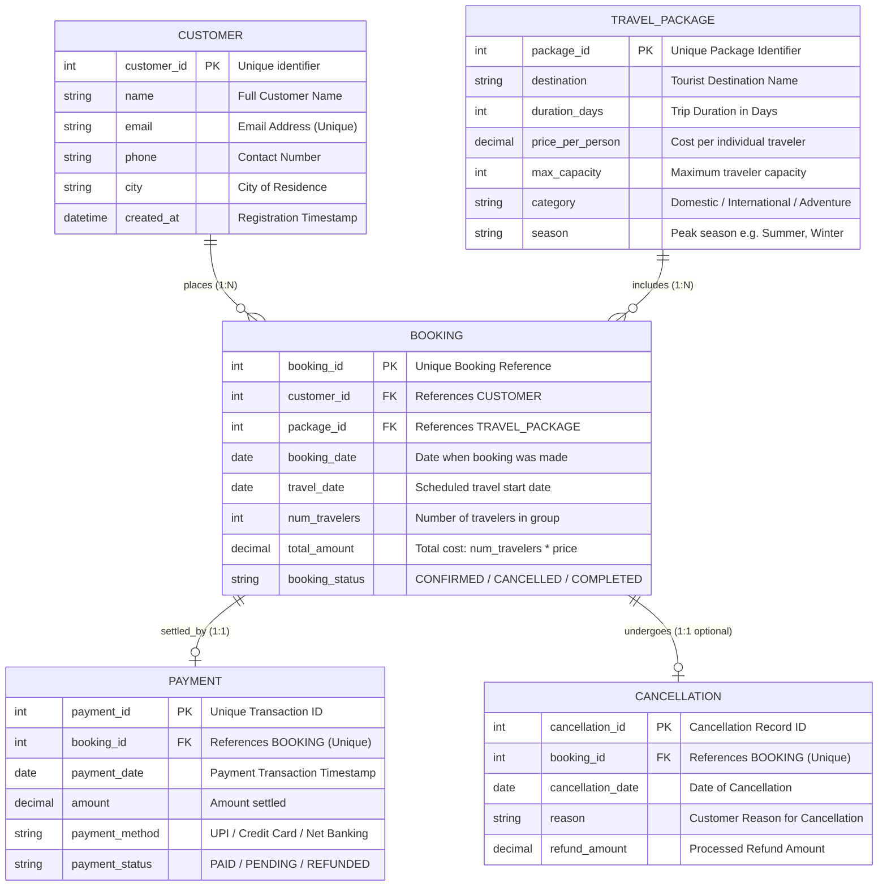

# Entity-Relationship (ER) Diagram and Relational Schema
## Travel Agency Booking and Tourism Trend Analysis System
**Course Code & Title:** 25ITT31 - Database Management Systems (Unit 1: Database Systems and Design)  
**Student:** Kishor K (RegNo: 732925ITR051)  
**Class:** 25IT3A  

---

## 1. Entity-Relationship (ER) Diagram

---

## 2. Relational Model Specification

The conceptual ER model maps directly to five normalized relational tables:

1. **`customers`**
   * **Schema:** `customers (`<u>`customer_id`</u>`, name, email, phone, city, created_at)`
   * **Primary Key:** `customer_id`
   * **Integrity Constraints:** `email` is UNIQUE and NOT NULL; `phone` is NOT NULL.

2. **`travel_packages`**
   * **Schema:** `travel_packages (`<u>`package_id`</u>`, destination, duration_days, price_per_person, max_capacity, category, season)`
   * **Primary Key:** `package_id`
   * **Integrity Constraints:** `duration_days > 0`, `price_per_person > 0`, `max_capacity > 0`.

3. **`bookings`**
   * **Schema:** `bookings (`<u>`booking_id`</u>`, `<em>`customer_id`</em>`, `<em>`package_id`</em>`, booking_date, travel_date, num_travelers, total_amount, booking_status)`
   * **Primary Key:** `booking_id`
   * **Foreign Keys:**
     * `customer_id` \(\rightarrow\) `customers(customer_id)` ON DELETE RESTRICT
     * `package_id` \(\rightarrow\) `travel_packages(package_id)` ON DELETE RESTRICT
   * **Integrity Constraints:** `num_travelers > 0`, `booking_status IN ('CONFIRMED', 'CANCELLED', 'COMPLETED')`.

4. **`payments`**
   * **Schema:** `payments (`<u>`payment_id`</u>`, `<em>`booking_id`</em>`, payment_date, amount, payment_method, payment_status)`
   * **Primary Key:** `payment_id`
   * **Foreign Key:** `booking_id` \(\rightarrow\) `bookings(booking_id)` ON DELETE CASCADE
   * **Integrity Constraints:** `amount >= 0`, `payment_status IN ('PAID', 'PENDING', 'REFUNDED')`.

5. **`cancellations`**
   * **Schema:** `cancellations (`<u>`cancellation_id`</u>`, `<em>`booking_id`</em>`, cancellation_date, reason, refund_amount)`
   * **Primary Key:** `cancellation_id`
   * **Foreign Key:** `booking_id` \(\rightarrow\) `bookings(booking_id)` ON DELETE CASCADE
   * **Integrity Constraints:** `refund_amount >= 0`.

---

## 3. Cardinality & Participation Constraints
- **Customer to Booking (1:N):** One customer can make zero or many bookings. A booking must be associated with exactly one customer (Mandatory / Total participation).
- **Travel Package to Booking (1:N):** A package can have zero or many bookings up to its `max_capacity`. Each booking references exactly one package.
- **Booking to Payment (1:1):** Each booking has a corresponding payment record to track invoice status.
- **Booking to Cancellation (1:0..1):** A booking may or may not be cancelled (Partial participation). If cancelled, exactly one cancellation entry is recorded, freeing the allocated capacity.
