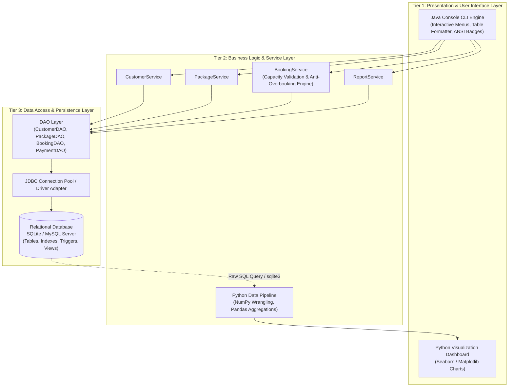
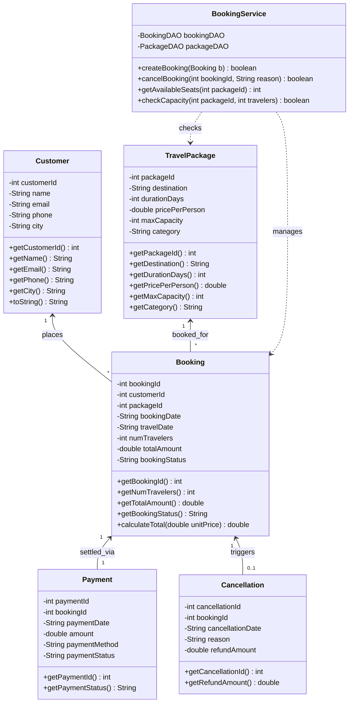
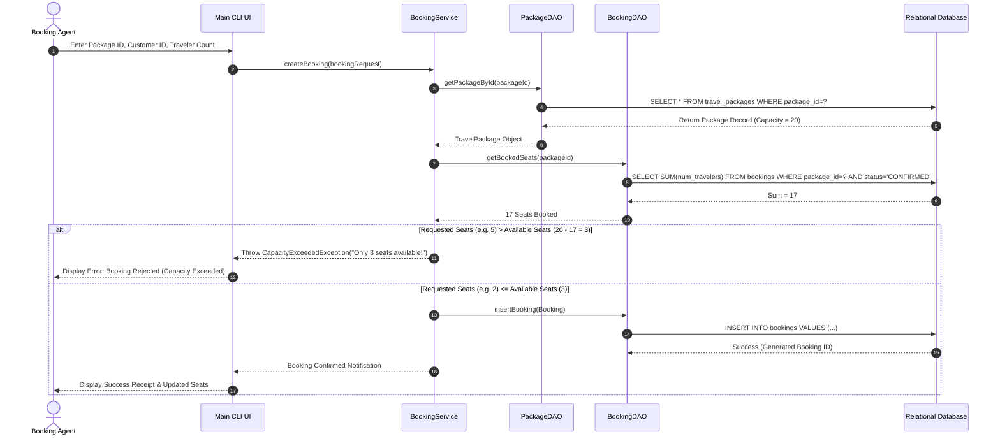

# System Design and Architecture Document
## Travel Agency Booking and Tourism Trend Analysis System
**Student:** Kishor K (RegNo: 732925ITR051)  
**Class:** 25IT3A  
**Institution:** Velalar College of Engineering and Technology, Erode - 12  
**Department:** Information Technology  

---

## 1. System Architecture

The system utilizes a 3-Tier Layered Architecture engineered for separation of concerns, high cohesion, low coupling, and data consistency.



---

## 2. Use Case Diagram

The Use Case model defines the functional interactions between the system actors (**Customer**, **Booking Agent / Travel Desk**, and **Data Analyst / Administrator**) and the core application modules.

```mermaid
flowchart LR
    Customer((Customer / Client))
    Agent((Booking Agent))
    Admin((Agency Admin / Analyst))

    subgraph "Travel Agency Booking & Analysis System"
        UC1(["Register / Update Customer Profile"])
        UC2(["Search & View Travel Packages"])
        UC3(["Book Travel Package with Headcount"])
        UC4(["Check Live Availability & Prevent Overbooking"])
        UC5(["Record Payment & Manage Status"])
        UC6(["Cancel Booking & Release Seats"])
        UC7(["Generate Operational Revenue Reports"])
        UC8(["Execute Tourism Trend Analysis & Forecast"])
    end

    Customer --> UC1
    Customer --> UC2
    Customer --> UC3

    Agent --> UC1
    Agent --> UC2
    Agent --> UC3
    Agent --> UC4
    Agent --> UC5
    Agent --> UC6
    Agent --> UC7

    Admin --> UC2
    Admin --> UC7
    Admin --> UC8

    UC3 ..>|<<include>>| UC4
    UC3 ..>|<<include>>| UC5
    UC6 ..>|<<include>>| UC4
```

---

## 3. Class Diagram

The Class Diagram highlights the Object-Oriented Principles (Encapsulation, Inheritance, Polymorphism, Abstraction) implemented in the Java source codebase.



---

## 4. Sequence Diagram: Booking Creation with Overbooking Guard

This Sequence Diagram depicts how the system evaluates capacity dynamically before committing any reservation.



---

## 5. Architectural Quality Attributes & Design Patterns
- **Data Access Object (DAO) Pattern:** Isolates database operations behind uniform interfaces (`CustomerDAO`, `PackageDAO`, `BookingDAO`).
- **Service Layer Pattern:** Encapsulates business logic, transactional checks, and validations away from presentation code.
- **Fail-Safe Capacity Guard:** Ensures concurrency and consistency so that total confirmed travelers never exceed package capacity limits.
- **Loose Coupling:** The Python data visualization module acts independently on the shared database tables without depending on the Java runtime.
